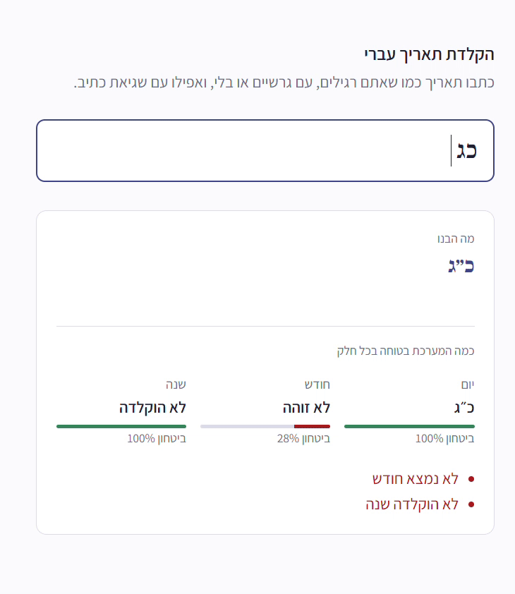

# קריאת תאריכים עבריים בהקלדה חופשית

מודל למידת מכונה (ML.NET) שמקבל תאריך עברי כפי שאנשים מקלידים אותו באמת, ומחזיר יום, חודש, שנה ותאריך לועזי.



**[לנסות בעמוד ההדגמה](https://YOUR-APP.onrender.com)**

המודל מבין כתיבות שונות של אותו תאריך:

| מה שהוקלד | יום | חודש | שנה |
|---|---|---|---|
| `ט״ו בשבט תשפ״ז` | 15 | Shevat | 5787 |
| `טו שבט` | 15 | Shevat | (לא הוקלדה) |
| `כ"ה כסליו ה'תש"ף` | 25 | Kislev | 5780 |
| `י״ד אדר ב׳ תשפ״ד` | 14 | AdarII | 5784 |
| `ג מרחשוון` | 3 | Cheshvan | (לא הוקלדה) |

הוא עומד גם בגרש וגרשיים מסוגים שונים (`׳ ״` או `' "`) או בלעדיהם, אותיות סופיות בשנה (`תש״ף`), "ב" לפני החודש, ושגיאות הקלדה בשם החודש.

## איך זה בנוי

הפרויקט מחולק לשלושה שלבים, כל אחד בתיקייה משלו:

1. **[create_examples](create_examples/)**: מייצר נתוני אימון. עובר על כל יום מ־1600 עד 2200, וכותב כל תאריך בשלוש צורות אקראיות שונות (כתיב החודש, סימני פיסוק, עם שנה או בלי, ושגיאות הקלדה ב־15% מהשורות).
2. **[train_AI](train_AI/)**: מאמן חמישה מודלים קטנים: יום, חודש, וספרה לכל אחת משלוש האותיות של השנה (מאות, עשרות, יחידות). פיצול השנה לשלוש ספרות מהיר בהרבה מאימון מודל אחד עם כ־600 שנים אפשריות.
3. **[server](server/)**: שרת ASP.NET שטוען את המודלים ומגיש את עמוד ההדגמה ואת ה־API.

כל מודל מחזיר גם רמת ביטחון. השרת מתעלם מתשובה שהביטחון בה נמוך מ־80%, ומדווח על כך במקום לנחש.

## הרצה

צריך [.NET 10 SDK](https://dotnet.microsoft.com/download).

המודלים המאומנים כבר נמצאים ב־[server/models](server/models/), כך שאפשר להריץ את השרת מיד:

```bash
cd server
dotnet run
```

ואז לפתוח בדפדפן את הכתובת שמודפסת.

### אימון מחדש

```bash
cd create_examples
dotnet run          # כותב data/hebrew_dates.csv

cd ../train_AI
dotnet run          # מאמן ושומר את המודלים ב־models/, ואז מאפשר לנסות אותם בטרמינל
```

`train_AI` טוען מודלים קיימים מתיקיית `models` אם הם שם, אז כדי לאמן מחדש יש למחוק אותה קודם. בסיום מעתיקים את קובצי ה־`.zip` ל־`server/models`.

## API

```
GET /parse?text=ט״ו בשבט תשפ״ז
```

```json
{
  "text": "ט״ו בשבט תשפ״ז",
  "day": 15,
  "month": "Shevat",
  "year": 5787,
  "gregorianDate": "2027-01-23",
  "problems": [],
  "confidence": { "day": 1, "month": 1, "year": 0.99 }
}
```

ערכי `confidence` כאן הם להמחשה. חלק שהמודל לא בטוח בו מוחזר כ־`null`, וההסבר מופיע ב־`problems` (למשל `"No year was typed"`).

## מגבלות

- שנים בטווח ה׳ש״ס עד ה׳תתקס״א בערך (1600–2200), בלי האלף (`ה׳` הוא אופציונלי ותמיד מתפרש כאלף השישי).
- שגיאות הקלדה נלמדו רק בשם החודש, לא ביום או בשנה.
